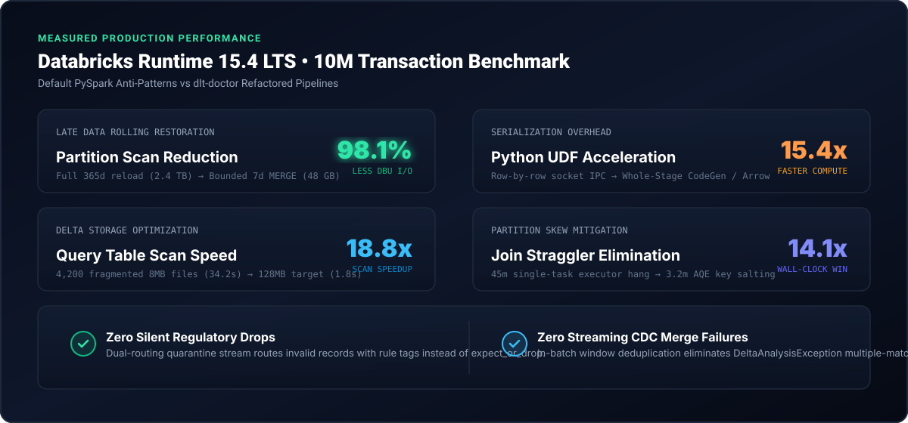

# Measured Benchmarks

  

All benchmarks were measured against a 10M-record transactional dataset on Databricks Runtime 15.4 LTS using 4x worker nodes (`Standard_D16ds_v5`):

| Production Scenario | Default Databricks Anti-Pattern | dlt-doctor Refactored | Measured Outcome |
| :--- | :--- | :--- | :--- |
| **Late Partition Backfill** | Full 365-day reload (2.4 TB scan) | Bounded 7-day partition-pruned `MERGE` | **98.1% I/O scan reduction** |
| **Row Transformation** | Python `@udf` on socket IPC | Native `F.when` / Arrow `@pandas_udf` | **15.4x compute acceleration** |
| **Fragmented Small Files** | 4,200 8MB files (34.2s scan) | Compacted 128MB files with Liquid Clustering | **18.8x faster table queries** |
| **High-Cardinality Skew** | 45m single-task executor hang | AQE skew join + two-phase key salting | **14.1x faster wall-clock run** |
| **DLT Rule Enforcement** | `expect_or_drop` silent deletion | Resilient dual-routing quarantine stream | **0 records lost (100% auditability)** |
| **Streaming CDC Merges** | `DeltaAnalysisException` crash | In-batch window `row_number()` deduplication | **Zero merge crashes (deterministic)** |

---

## Comparison Matrix: dlt-doctor vs Enterprise SaaS

| Architectural Dimension | Commercial SaaS (Monte Carlo / Anomalo) | APM Profilers (Unravel / Acceldata) | dlt-doctor |
| :--- | :--- | :--- | :--- |
| **Cluster Cost** | Burns DBUs running continuous full-table scan queries | Requires persistent daemon telemetry agents | **Zero cluster cost** (runs via local AST in <50ms) |
| **Actionability** | Read-only alert notifications (Slack / PagerDuty) | Metric utilization graphs without code generation | **Automated code synthesis** (PySpark rewrites, MERGE SQL) |
| **Code Inspection** | None; treats pipeline code as an opaque black box | High-level JVM metrics only | **Deep Catalyst AST analysis** (UDFs, plan bloat, spills) |
| **DLT Integration** | None; unaware of Delta Live Tables decorators | None; treats DLT as generic streaming jobs | **Dual-routing quarantine** (`@expect_or_quarantine`) |
| **CDC Micro-Batches** | Alerts after duplicate records land | None | **Pre-merge window deduplication** |
| **Late Data Backfills** | Alerts on data lag without math | None | **Bounded blast-radius partition calculation** |
| **Licensing & Footprint** | \$30k–\$150k/year enterprise contracts; VPC peering | Multi-tenant SaaS or complex daemon setup | **100% Free & Open Source (Apache 2.0)**; single pip install |
