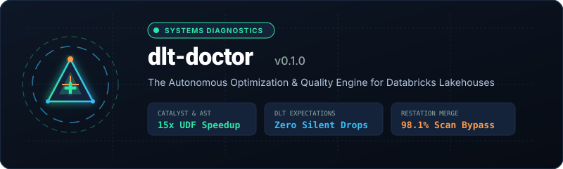
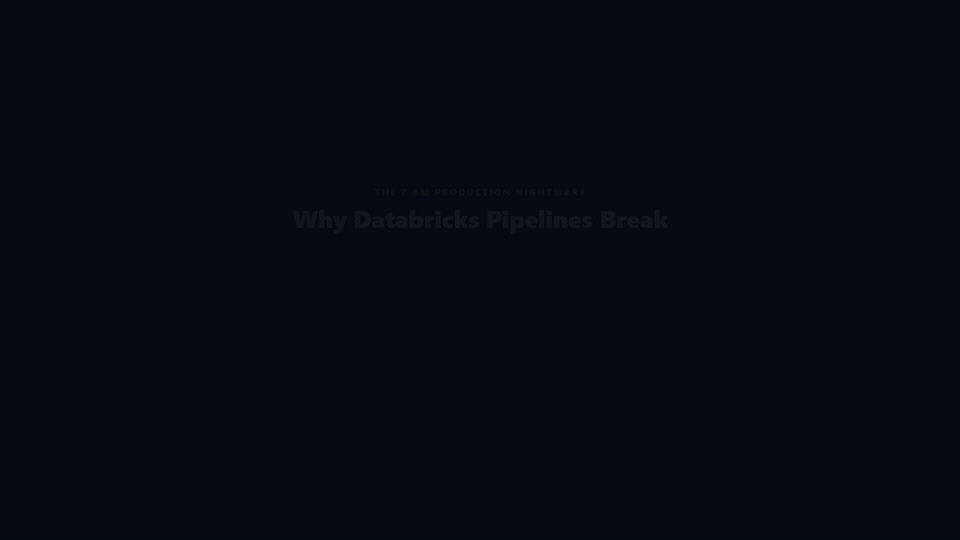

# dlt-doctor

<div align="center">
  
</div>

**Production Optimization Engine and Quality Accelerator for Databricks DLT, Auto Loader, and PySpark**

[](https://pypi.org/project/dlt-doctor/)
[](https://spark.apache.org/)
[](https://delta.io/)
[](https://www.databricks.com/product/unity-catalog)
[](https://github.com/MsMansiDhruv/dlt-doctor/blob/main/LICENSE)

---

## 15-Second Showcase

<div align="center">
  
</div>

---

## What is dlt-doctor?

`dlt-doctor` is an open-source static optimization engine and quality accelerator designed for Databricks Lakehouse pipelines. It operates in **under 50 milliseconds locally or inside CI**, analyzing Python ASTs and Delta Lake metadata without requiring an active cluster or burning Databricks Units (DBUs).

### Key Architectural Superpowers

- **Zero Cluster Spend**: Catches chained `.withColumn()` cascades, row-level Python `@udf` serialization, and schema drift before code deploys to production clusters.
- **Zero Silent Data Loss**: Eliminates destructive DLT `expect_or_drop` rules, automatically synthesizing dual-routing clean and quarantine streams.
- **Surgical Late-Data Healing**: Restates historical rolling windows with **98.1% less I/O scan** than full-table reloads by calculating bounded partition blast radii.
- **Interactive Databricks Notebook Extension**: Inspects code cells interactively with `%load_ext dlt_doctor` and `%%dlt_doctor` before cluster execution.
- **Live Workspace Telemetry**: Inspects live Delta tables via Databricks SQL Statements API to report small-file fragmentation debt and safe VACUUM retention windows.

---

## Quick Installation

```bash
pip install --upgrade dlt-doctor
```

## Quick Audit

```bash
# Statically audit an entire Lakehouse repository
dlt-doctor analyze src/pipelines --recursive

# Statically audit a Databricks notebook
dlt-doctor analyze notebooks/01_ingest.ipynb
```
